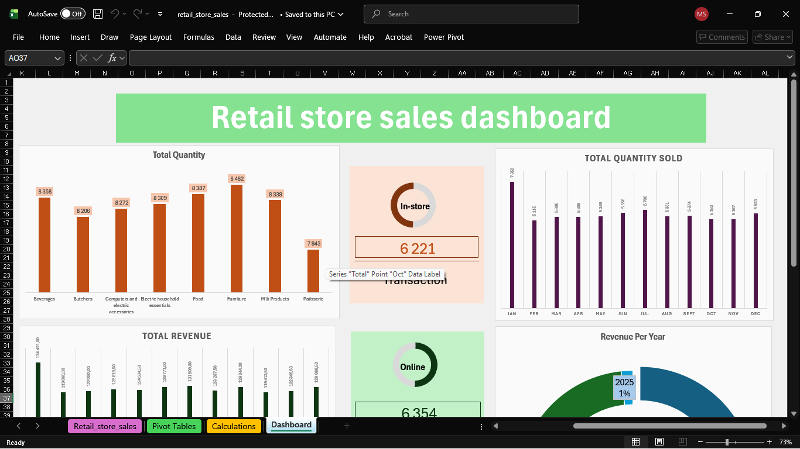
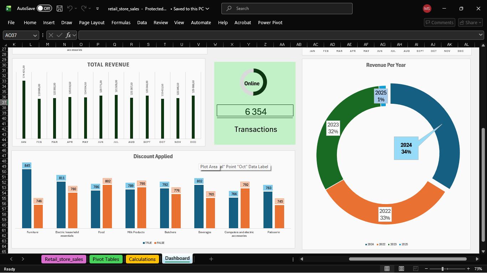
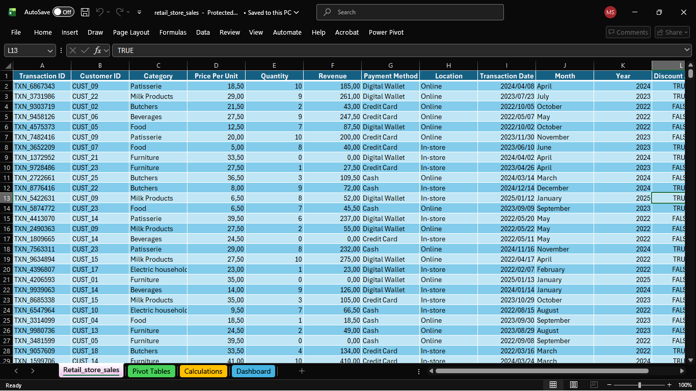
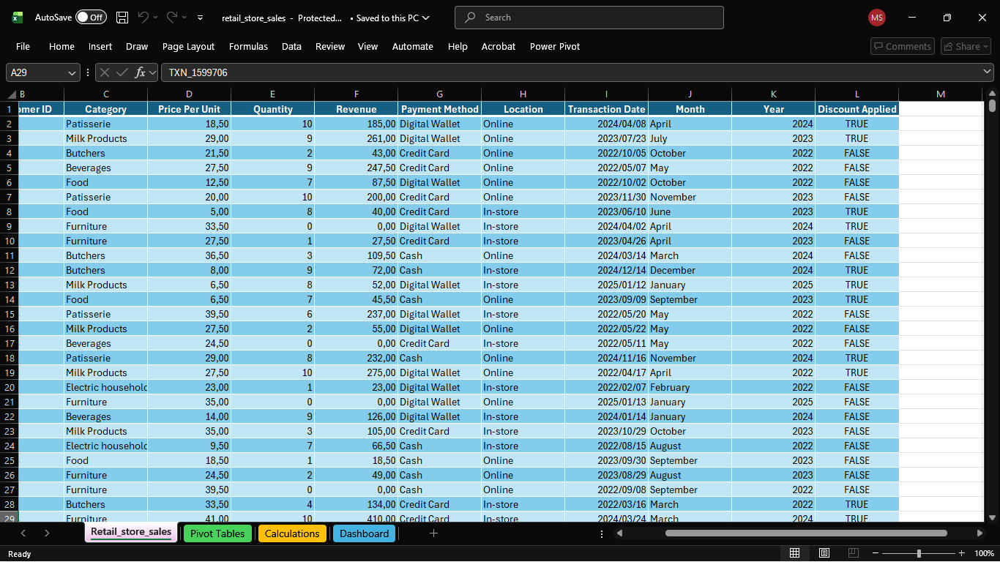
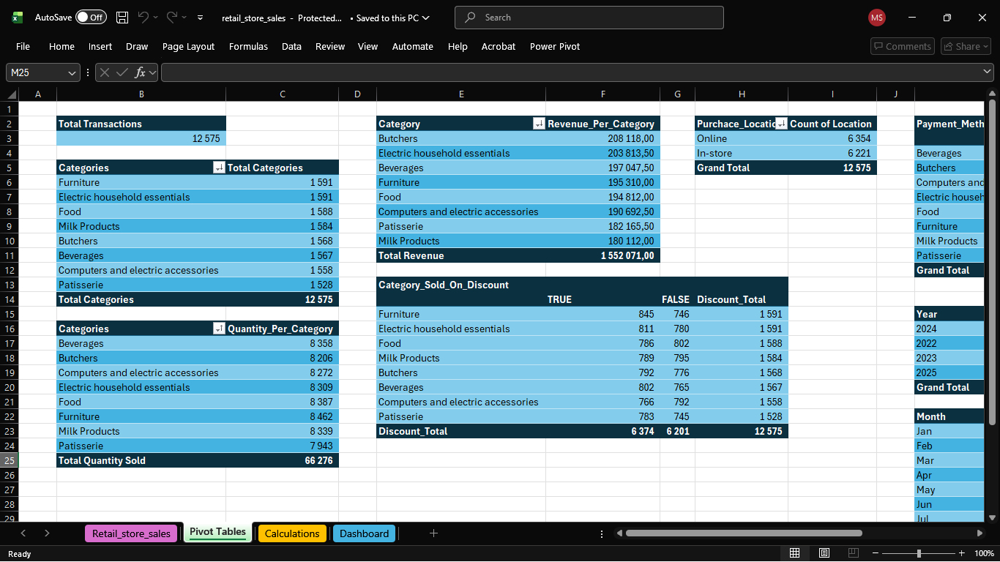

# Retail Store Sales Analytics Dashboard — Excel

## Overview
An end-to-end Excel project that cleans, validates and analyses the **Dirty Retail Store Sales** dataset ([source](https://www.kaggle.com/datasets/ahmedmohamed2003/retail-store-sales-dirty-for-data-cleaning/data)). It contains 12,575 rows of synthetic sales transactions across eight product categories, each with 25 items at static prices. The data is deliberately "dirty", with missing and inconsistent values that simulate real-world sales data.

The project takes the raw dataset through cleaning, validation, calculation and visualisation, producing a dashboard of revenue, quantity, discount behaviour, purchase location and payment method by category.

## Dashboard

## Business Questions Addressed
- Which categories drive the most revenue and the most units sold?
- Does discount usage differ by category?
- How are transactions split between Online and In-store, and across payment methods?
- How does revenue change by month and by year?
- Which missing values can be recovered with certainty, and which must be left as gaps?

## Data Model
Built on a single flat table with one row per transaction (12,575 rows). PivotTables on a separate Calculations sheet feed the dashboard.

**Fields:** Transaction ID, Customer ID, Category, Item, Price Per Unit, Quantity, Total Spent, Payment Method, Location, Transaction Date, Discount Applied. Month and Year columns were derived from the transaction date for the time analysis.

## Data Profiling
- **Missing data** appears in `Item`, `Price Per Unit`, `Quantity` and `Total Spent`.
- **Transaction ID** is always unique and present, and **Customer ID** is always valid (drawn from 25 unique customers).
- **A fixed relationship links three columns:** `Total Spent = Price Per Unit × Quantity`, so a single missing value among them can be calculated exactly.
- **`Item` values** follow the pattern `Item_<number>_<ABBREVIATION>` (for example `Item_10_PAT`).
- **Each category maps to exactly one item abbreviation** across the full dataset, confirmed with a PivotTable of Category → Item with Min and Max price (for example Patisserie → PAT, Milk Products → MILK).
- **Some transactions are only partly complete**, so values must be inferred where possible.

## Data Challenges and Decisions
- **One missing value among Price Per Unit, Quantity and Total Spent.** The relationship `Total Spent = Price Per Unit × Quantity` recovers the missing value exactly. *Decision:* calculate it instead of estimating it (blank Total Spent = Price × Quantity, blank Quantity = Total Spent ÷ Price, blank Price = Total Spent ÷ Quantity). The formulas use `IFERROR` and `ISNUMBER` checks to avoid `#VALUE!` errors from stray blank or text-formatted cells.
- **Two or more of those three missing.** There is not enough information to back-calculate anything. *Decision:* leave these rows incomplete, because inventing a value would quietly corrupt revenue totals.
- **Messy `Item` text.** Only the abbreviation was needed. *Decision:* extract it with `TEXTAFTER(cell, "_", -1)`, wrapped in `IFERROR` so already-blank cells stay untouched.
- **Blank `Item`.** The first plan was to infer it from `Category`. *Decision:* test that plan before using it. The Category → Item PivotTable confirmed a one-to-one mapping, so blanks are filled with a `VLOOKUP` against a Category → Item table. This would not have been safe if a category contained several items.
- **Formula errors in the Calculations sheet.** The verification layer exposed two problems:
  - Several `COUNTIFS` formulas (Payment Method Per Category and Category Sold On Discount) pointed at a single fixed cell in the raw data instead of the label cells on the Calculations sheet. This duplicated values across categories (Milk Products showed identical counts for Cash, Credit Card and Digital Wallet) and left grand totals that did not reconcile to 12,575.
  - A `SUMIF` formula in Revenue Per Month had the same problem, so March, April and May (and January, September and October) returned identical, incorrect totals.

  *Fix:* criteria now reference the row and column labels on the Calculations sheet, using mixed `$` references so the formulas copy across the whole table. All totals then reconciled to 12,575 transactions.

## Process
1. **Profiling:** reviewed missing values, relationships between columns and the structure of `Item`.
2. **Cleaning:** applied the decisions above.
3. **Verification:** built a separate Calculations sheet to cross-check every dashboard figure instead of trusting PivotTable output at face value.
4. **Visualisation:** built the dashboard with PivotCharts, using a consistent colour palette (navy for primary metrics and Online, orange for secondary metrics and In-store, gold for top performers, light blue-grey for de-emphasised comparisons).

## Key Measures
| KPI | Definition |
|---|---|
| Total Transactions | Count of transactions (12,575) |
| Total Revenue | Sum of Total Spent (1,552,071) |
| Total Quantity Sold | Sum of Quantity (66,276) |

Totals sum the recorded values, and rows left incomplete are not estimated.

## Dashboard Visuals
- Total revenue, and revenue by category
- Total quantity sold, and quantity by category
- Discount usage (TRUE/FALSE) by category
- Purchase location split (Online vs In-store)
- Payment method split (Cash / Credit Card / Digital Wallet) by category
- Revenue by month and by year

## Key Insights
- **Revenue is evenly distributed across categories.** Total revenue is 1,552,071 across 8 categories, and every category falls between 180,000 and 208,000 (Butchers highest at 208,118, Milk Products lowest at 180,112), a spread of about 15% from top to bottom.
- **Quantity sold does not track revenue exactly.** Furniture leads in units sold (8,462) but ranks only fourth in revenue, while Butchers has fewer transactions but the highest revenue. This points to a higher average price per unit for Butchers (about 25.4 vs 23.1 for Furniture).
- **Discount usage is close to 50/50 in every category** (6,374 discounted vs 6,201 not), so no category is discounted disproportionately.
- **Purchase location is close to even** (Online 6,354 vs In-store 6,221).
- **Payment method is close to a three-way even split** (Cash 4,310, Credit Card 4,121, Digital Wallet 4,144), both overall and within each category.
- **The near-total uniformity is consistent with the data being synthetic,** as its source describes. It is worth stating plainly rather than forcing charts to imply patterns the data does not support.

## Limitations
- **No profit data.** The dataset has revenue (`Total Spent`) but no cost column, so profitability cannot be calculated. All figures are revenue, not profit.
- **Rows with two or more missing values** among Price Per Unit, Quantity and Total Spent were left incomplete rather than estimated.
- **Time analysis depends on date parsing.** 2025 revenue looks low because the dataset's 2025 records are partial (the year was in progress), not because sales fell.
- The dataset is synthetic, so findings describe patterns in this data, not real market behaviour.

## Tools Used
Microsoft Excel (formulas, PivotTables, PivotCharts)

## Author
**Sello Mpho** · Bloemfontein, South Africa
[Portfolio](https://mpho-sello.vercel.app/) · [LinkedIn](https://www.linkedin.com/in/mpho-sello-692193241) · sellompho1601@gmail.com
